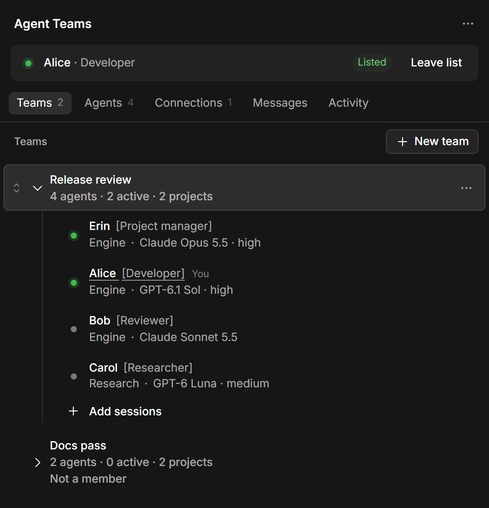
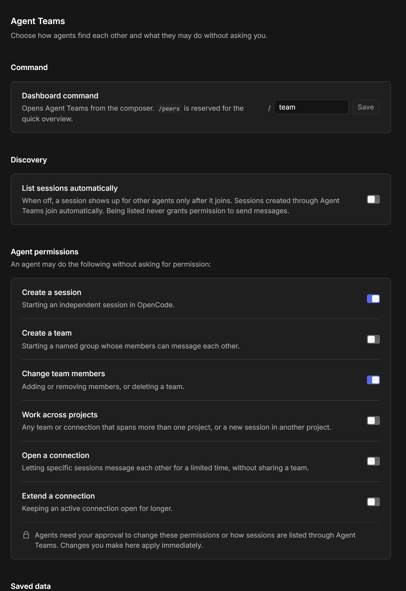

<p align="center">
  
</p>

# Agent Teams

**Let your OpenCode sessions collaborate.** Agent Teams is a native OpenCode V2 plugin that lets agents find and message each other directly, and organise into teams across projects.

Every session is a peer, so it is up to you to define roles in context. It all runs on OpenCode's own plugin APIs and storage, with no separate service or database.

> **Experimental, shared as is.** See [Licence and support](#licence-and-support).

## What it does

- **Direct messaging between sessions.** Agents send each other native synthetic messages. An idle recipient wakes up, and a busy one receives the message at its next step, without cancelling work in progress.
- **Teams.** A team is a named group of sessions whose members can message each other until it is deleted, including across projects.
- **Connections.** A connection is a temporary link between specific sessions that need to talk without sharing a team, typically across projects.
- **Self-organising.** One agent can start a team by itself and then create its own teammates, who join automatically.
- **You stay in control.** Under **Agent permissions**, you choose what an agent may do without asking. Everything else goes through OpenCode's native approval dialogue, and an agent can't change these permissions through the Agent Teams tools without your approval. The settings themselves are a user API, so anything holding your OpenCode server credentials can change them, including an agent that can run commands on your machine.
- **Desktop and TUI.** A Desktop side panel and settings page built from OpenCode's own components, plus native TUI dialogues and slash commands.
- **Honest delivery tracking.** Messages are *Sent*, *Delivered*, *Handled* or *Unconfirmed*, and are never silently resent.

## In OpenCode Desktop

<table>
  <tr>
    <td width="50%" valign="top">
      
      <p>In the side panel, <strong>Teams</strong> shows each member's name, role, project and model, with a dot for active or idle. The panel also has <strong>Agents</strong>, a searchable list of sessions, and <strong>Connections</strong>, which let sessions in different projects talk for a limited time. <strong>Messages</strong> shows delivery status, and <strong>Activity</strong> shows what changed. Right-click a team, a member or an agent to manage it.</p>
    </td>
    <td width="50%" valign="top">
      
      <p>In <strong>Settings</strong> you define the dashboard command, discovery, and what agents may do without asking.</p>
    </td>
  </tr>
</table>

## Requirements

- OpenCode V2 **2.2.5** or a later V2 release. 2.2.5 and 2.2.6 are the verified versions, so newer releases may need checking.
- OpenCode Desktop with the experimental GUI plugin API (for the Desktop panel).
- Node.js 24 or later and npm, only to build from source.

## Install

```sh
opencode plugin add agent-teams-for-opencode
```

OpenCode downloads the plugin from npm, adds it to `plugins` in your global config and loads it. Then open a session and run `/team` for the dashboard or `/peers` for a quick overview. In Desktop, choose **Agent Teams** from the side panel's **New tab** page or **+** menu.

## Update

```sh
opencode plugin check
opencode plugin update agent-teams-for-opencode
```

`check` tells you whether a newer version is out, and `update` installs it. A running OpenCode switches to the new version within a few seconds, without a restart. If Desktop still shows the old panel, reload the window. Update while no agent has a tool call in progress, and if the command reports a dropped connection, run it again.

Your teams, history and settings carry over, because they're stored under the plugin's ID rather than its version.

## Install from source

1. Build the package:

   ```sh
   git clone https://github.com/tristanripke/agent-teams-for-opencode.git
   cd agent-teams-for-opencode
   npm ci --ignore-scripts
   npm run check
   npm test
   npm run build
   npm pack
   ```

2. Prepare the plugin next to OpenCode's global plugin directory, then move it in once it's complete. OpenCode loads whatever appears in `plugins` straight away, and a load that finds no dependencies keeps failing on that path until OpenCode restarts. The config root is `$XDG_CONFIG_HOME/opencode` when set, otherwise `$HOME/.config/opencode` (on Windows, PowerShell's `$HOME` is your user profile).

   **macOS/Linux:**

   ```sh
   config="${XDG_CONFIG_HOME:-$HOME/.config}/opencode"
   stage="$config/agent-teams-install"
   mkdir -p "$stage" "$config/plugins"
   tar -xzf agent-teams-for-opencode-0.2.0.tgz -C "$stage" --strip-components=1
   npm install --prefix "$stage" --omit=dev --ignore-scripts
   mv "$stage" "$config/plugins/agent-teams-for-opencode"
   ```

   **PowerShell:**

   ```powershell
   $configBase = if ($env:XDG_CONFIG_HOME) { $env:XDG_CONFIG_HOME } else { Join-Path $HOME '.config' }
   $stage = Join-Path $configBase 'opencode/agent-teams-install'
   $plugins = Join-Path $configBase 'opencode/plugins'
   New-Item -ItemType Directory -Force -Path $stage, $plugins | Out-Null
   tar -xzf agent-teams-for-opencode-0.2.0.tgz -C $stage --strip-components=1
   npm install --prefix $stage --omit=dev --ignore-scripts
   Move-Item $stage (Join-Path $plugins 'agent-teams-for-opencode')
   ```

   OpenCode discovers this directory automatically, so don't also add it with `opencode plugin add`. Install while no agent has a tool call in progress. To update, extract the new archive over the installed folder and run the same `npm install` there. If the plugin doesn't appear, restart OpenCode.

3. Open a session and run `/team`, as above.

## Uninstall

Removing the plugin doesn't delete what it saved, so remove the saved data first. Your teams, history and settings live in OpenCode's own database, not in the plugin folder, and this plugin doesn't encrypt them.

1. Open **Settings → Agent Teams → Remove saved data** and confirm. In the TUI, it's under the dashboard's **Settings**. This can't be undone. Do this with a session open in Desktop if you can, as explained below.
2. While agents are idle, run `opencode plugin remove agent-teams-for-opencode`. If you installed from source, delete the installed `opencode/plugins/agent-teams-for-opencode` directory from your config root instead. Neither removes the saved data, which is why step 1 comes first.

Please don't delete OpenCode's database to do this, as it also holds your sessions.

A few things stay behind, and they're yours to remove if you wish:

- **Delivered messages.** A message delivered to an agent is part of that session's conversation, and it's deleted along with the session.
- **Sessions the plugin created.** These are ordinary sessions, so delete them as you would any other.
- **Saved team expansion.** Desktop remembers which teams are expanded for each session, as team IDs only. The plugin can only clear this for the session that's open.
- **Your config.** Any `options.limits` you added stays until you remove it.
- **The downloaded package.** OpenCode keeps a copy in its cache folder.
- **Your checkout.** If you built from source, the clone, its `node_modules` and the packed archive stay wherever you built them.

## Quick start

1. **Join the list.** Sessions are unlisted by default. Select **Join list** in the panel, or let an agent call `manage` with `{"action":"discovery.register","input":{}}`. If you prefer to have all sessions listed by default, turn on **Settings → Agent Teams → List sessions automatically**.
2. **Make a team.** Select **New team**, name it and pick members. A team can start with just one agent.
3. **Let agents talk.** Sessions in the same project can message each other straight away, whereas those in different projects need a shared team or an open connection.
4. **Or let an agent build its team.** Ask an agent to create teammates: it calls `session.create` with the team's `teamID`, and each new session joins the team, ready for work.

## Agent permissions

**Settings → Agent Teams → Agent permissions**: *An agent may do the following without asking for permission:*

| Permission | Covers |
| --- | --- |
| Create a session | Starting an independent session in OpenCode. |
| Create a team | Starting a named group whose members can message each other. |
| Change team members | Adding or removing members, or deleting a team. |
| Work across projects | Any team or connection that spans more than one project, or a new session in another project. |
| Open a connection | Letting specific sessions message each other for a limited time, without sharing a team. |
| Extend a connection | Keeping an active connection open for longer. |

A switch that is **on** lets the agent go ahead (`allow`), while **off** means it asks you first through OpenCode's native approval dialogue (`ask`). Refusing a prompt only refuses that one request, so you will be asked again next time.

A permission can also be `deny`, which refuses the request before any prompt appears and shows as **Currently blocked** in settings. If you would like to set it, ask your agent to request it, which will create an approval dialogue. You can also call the plugin's `configure` RPC. Switching a blocked row on sets it to `allow`.

An agent's request to change these permissions, or how sessions are listed, always needs your approval. Agents can see their own permissions, session quota and remaining message allowance in `discover`, so they can check before acting.

The approval dialogue describes each request in words, with session names and folders, for example *Alice asks to connect 2 sessions for 60 minutes:* followed by one line for each session, such as *Bob (C:/Projects/API)*.

These permissions limit agents, not you. When you use the panel's or the TUI's own controls, such as **Connect** or **New agent session**, your click is the approval: they act as the open session without a prompt, and **Activity** records them as yours. Permissions and how sessions are listed are changed only in **Settings**.

## For agents: the `peers` tools

| Tool | Purpose |
| --- | --- |
| `discover` | Peers, teams, connections and the agent's newest messages (up to 50 and about 64 KiB), plus `self` (permissions, quota, messages left this minute). Each peer shows whether it's running or idle, and `waitingFor` says when it's waiting for you to approve something or answer a question. `agents` holds up to 100 listed peers, newest first, with `agentsOmitted` counting the rest. Archived sessions aren't listed. `compact: true` gives a short summary, and `catalog: true` lists valid agents and models for `session.create`. |
| `send` | Send or reply. Needs a recipient, the text and a stable retry key. |
| `acknowledge` | Mark a received message as handled. |
| `manage` | Profile, teams, connections, new sessions and permission requests. |

`manage` describes itself: its schema lists every action's fields, and its description includes an example for each. If a request is refused, the response is `{"error":{...}}`, naming the problem fields, the constraint and what to do next:

```json
{"error":{"code":"invalid_action_input","action":"session.create","missing":["agent"],"invalid":[],
  "hint":"agent must be one of: build, plan, general; ...","remedy":"Correct the listed fields and call again."}}
```

Example `send` and reply:

```json
{"to":"ses_RECIPIENT","key":"review-42","text":"Please review the retry handling."}
{"to":"ses_SENDER","key":"review-42-reply","replyTo":"msg_RECEIVED","text":"The retry handling is correct."}
```

Only reuse a key to retry the exact same message. A key protects against duplicates for 15 minutes from the first attempt, and after that it counts as a new send. Authorisation is checked again on every retry.

## How it behaves

- **Discovery is not permission.** Being listed lets others find a session, but messaging still requires a shared project, team or active connection.
- **Delivery states are separate.** *Sent* means OpenCode accepted it, *Delivered* means it reached the recipient's context, *Handled* means the recipient acknowledged it, and *Unconfirmed* means admission could not be confirmed. Unconfirmed messages are never resent automatically.
- **Revocation is forward-looking.** Removing a member or closing a connection stops new messages, but a message already accepted can still arrive.
- **Profiles are labels.** An agent's name and role in Agent Teams are separate from the native session title, and you can edit any member's labels from an expanded team: right-click the member and choose **Edit name and role**.
- **History rolls over per team.** Each team keeps its newest 2000 messages or about 8 MiB, whichever comes first, so a busy team only overwrites its own history, and running out of room never stops a message being sent. Connections have their own allowance.
- **Deleting a team deletes its history.** That covers its messages, Activity and retry records, and it also happens when all of a team's sessions are deleted. Two agents who share more than one team have their messages filed under one of them, so deleting that team deletes those messages too.
- **Teammates can keep going.** Long back-and-forths between members of a team have no length limit, so nothing automatically stops teammates stuck in a reply loop, other than the message rate limit. Keep an eye on **Messages** if a team is running unattended.
- **Limits are operator settings** in the plugin's `options.limits`: message size and rate, conversation length outside teams, connection lifetime and the number of sessions the plugin may create outside teams. See [configuration](docs/configuration.md).

## Interfaces

- **Desktop:** a side panel with Teams, Agents, Connections, Messages and Activity, with status dots for active, idle, waiting for input and waiting for approval. Messages and Activity each have their own remembered **Team** picker and a **Show older** button. Peer messages also trigger native toasts and notifications. Separately, the settings page works without an open session.
- **TUI:** the same sections through native dialogues, with **Actions** and **Settings** entries, palette and slash commands.

## Status

Agent Teams is verified against OpenCode V2 2.2.5 and 2.2.6 on Windows. Beyond the automated tests in this repository, I have worked with it via the Desktop app. The TUI's latest changes haven't been tested by me and are there for the sake of completeness. macOS and Linux haven't been tested. Please note that the GUI plugin API is experimental, so it may change between OpenCode releases.

## Licence and support

[MIT](LICENSE). Use it, change it, share it, and have fun.

This is an experimental project shared **as is**, without warranty, so active maintenance, response times, fixes, compatibility updates and feature delivery aren't promised. Issues and feature requests are welcome, although opening one doesn't guarantee a response or implementation.

## Development

```sh
npm ci --ignore-scripts
npm run check    # type check
npm test         # unit and adapter tests
npm run build    # rebuild every bundle in dist/
```

`npm run preview` serves the Desktop panel with synthetic data at <http://127.0.0.1:5176/?view=dashboard>, so the layout can be worked on without OpenCode. Its controls are stand-ins for OpenCode's own, which remain the visual reference. The two browser checks in `scripts/` run against that preview, and each file starts with the commands to run it.

Continuous integration runs the type check, the tests and the build, and fails when the committed `dist/` no longer matches `src/`.

- [Architecture and rules for agents](AGENTS.md)
- [Configuration and action inputs](docs/configuration.md)
- [Security](SECURITY.md)
- [Changelog](CHANGELOG.md)
